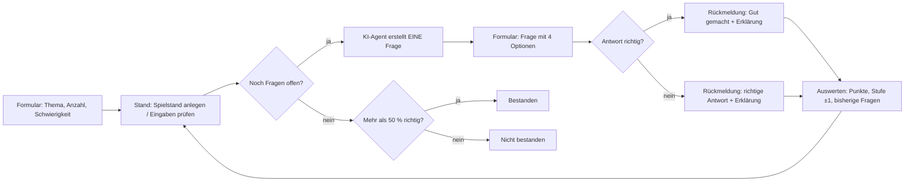
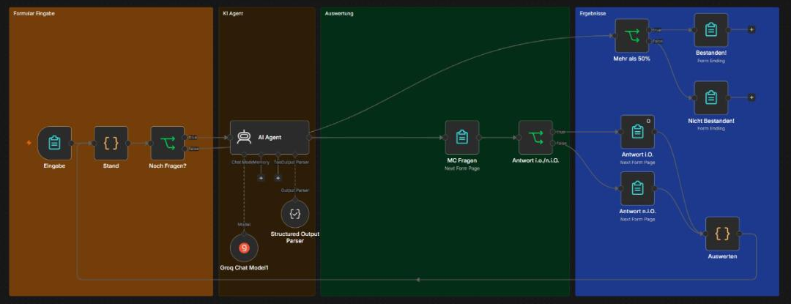

# Multiple-Choice-Generator mit n8n und KI

Ein n8n-Workflow, der zu einem beliebigen Thema Multiple-Choice-Fragen per KI erstellt, sie über ein Formular abfragt, die Antworten auswertet und am Ende anzeigt, ob man bestanden hat. In der letzten Ausbaustufe passt sich der Schwierigkeitsgrad nach jeder Antwort an (adaptives Lernen).

Entstanden im Rahmen der Weiterbildung „KI-Integrationsmanager:in (IHK)“ am Smart Future Campus.

## Projektziel

Lernen soll schnell und ohne Vorbereitung möglich sein: Thema eingeben, Fragen beantworten, sofort Rückmeldung bekommen. Der Workflow ersetzt das manuelle Erstellen von Übungsfragen und zeigt, wie man eine KI kontrolliert in einen Ablauf einbaut (festes JSON-Format, Prüfung der Antworten im Workflow statt durch die KI).

## Verwendete Tools

- n8n (Form Trigger, Form, If, Filter, Summarize, Split Out, Loop Over Items, Code)
- KI-Agent in n8n mit Structured Output Parser
- Groq als KI-Anbieter, Modell `openai/gpt-oss-20b`
- JavaScript im Code-Node (Ausbaustufe 4)

## Workflow

Die finale Version liegt in [`workflow.json`](workflow.json). Die Zwischenstände der einzelnen Ausbaustufen liegen im Ordner [`workflows/`](workflows).

**Ablauf Schritt für Schritt**

1. **Eingabe**: Über ein n8n-Formular wählt man Anzahl der Fragen, Thema und Schwierigkeit (Leicht, Mittel, Schwer oder Adaptiv).
2. **Stand**: Ein Code-Node legt beim ersten Durchlauf den Spielstand an (Nummer der Frage, Punkte, Stufe, bisher gestellte Fragen) und fängt fehlerhafte Eingaben ab, z. B. leeres Thema oder ungültige Anzahl.
3. **KI-Agent**: Erstellt genau eine Frage mit vier Antwortoptionen, der richtigen Antwort und einer kurzen Erklärung. Der Structured Output Parser erzwingt ein festes JSON-Format. Bereits gestellte Fragen werden mitgegeben, damit sich nichts wiederholt.
4. **Frage-Formular**: Die Frage wird mit den vier Optionen angezeigt.
5. **Prüfung**: Ein If-Node vergleicht die gewählte Antwort mit der richtigen Antwort. Die Prüfung macht der Workflow, nicht die KI.
6. **Rückmeldung**: Je nach Ergebnis „Gut gemacht“ oder die richtige Lösung, jeweils mit Erklärung.
7. **Auswerten**: Punkte werden hochgezählt. Im Modus Adaptiv steigt die Stufe nach einer richtigen Antwort um eins und sinkt nach einer falschen um eins (Grenzen: Leicht bis Schwer).
8. **Ergebnis**: Wenn alle Fragen beantwortet sind, entscheidet ein If-Node: mehr als 50 % richtig bedeutet bestanden.

## Ausbaustufen

| Stufe | Datei | Inhalt |
|---|---|---|
| 1 | `workflows/01_grundversion.json` | Workflow nachgebaut: KI erstellt alle Fragen auf einmal, Abfrage in einer Schleife |
| 2 | `workflows/02_punktesystem.json` | Punktesystem: Filter auf richtige Antworten, Zählen mit Summarize |
| 3 | `workflows/03_bestanden.json` | Zwei Ausgänge: bestanden ab mehr als 50 %, sonst nicht bestanden |
| 4 | `workflow.json` | Adaptives Lernen und Fehlerbehandlung der Eingaben: Fragen werden einzeln erzeugt, Spielstand im Code-Node |

## Screenshots

## Herausforderungen

- **Schleife ohne Loop-Node**: Für adaptives Lernen muss jede Frage einzeln erzeugt werden, weil die nächste Schwierigkeit von der letzten Antwort abhängt. Der Spielstand läuft deshalb im Kreis zwischen den Code-Nodes „Stand“ und „Auswerten“ (`$runIndex` unterscheidet den ersten Durchlauf).
- **Verlässliches KI-Format**: Ohne festes Schema lieferte die KI teils Text statt JSON. Gelöst mit klaren Regeln im Prompt und dem Structured Output Parser.
- **Leere Zählung**: Wenn alle Antworten falsch sind, liefern Filter und Summarize keine Daten und der Workflow stoppt. Abhilfe in Stufe 2 und 3: Option „Always Output Data“.
- **Doppelte Fragen**: Beim Einzelerzeugen kann die KI Fragen wiederholen. Die bisherigen Fragen werden deshalb im Prompt mitgegeben.
- **Fehleingaben**: Negative Anzahl oder leeres Thema hätten den Ablauf abgebrochen. Der Code-Node setzt dafür Standardwerte.

## Lernerfahrungen

- Formulare in n8n eignen sich gut für einfache Oberflächen ohne eigene Web-App.
- Die KI liefert Inhalte, die Logik (Prüfen, Zählen, Entscheiden) gehört in den Workflow. Das macht das Ergebnis nachvollziehbar.
- Mit Expressions (`{{ }}`) und kleinen Code-Nodes lassen sich Daten zwischen Nodes gezielt weitergeben.
- Schrittweise ausbauen und jede Stufe sichern spart Zeit bei der Fehlersuche.

## Einrichtung

1. In n8n: Workflow anlegen, über die drei Punkte „Import from File“ wählen und `workflow.json` laden.
2. Im Node „Groq Chat Model1“ eigene Groq-Zugangsdaten hinterlegen (kostenloser API-Key unter console.groq.com).
3. Workflow ausführen und das Formular über die Test-URL des Form Triggers öffnen.

Zugangsdaten sind in den JSON-Dateien nicht enthalten.

## Datenschutz

Es werden nur Thema und Schwierigkeit an den KI-Anbieter übertragen, keine personenbezogenen Daten. Die Antworten der Nutzer bleiben in n8n.
